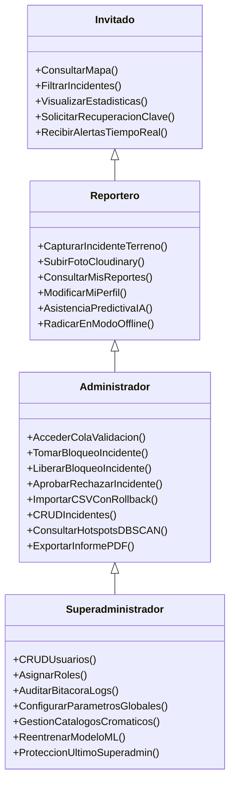

# ESPECIFICACIÓN DE REQUISITOS DE SOFTWARE (ERS)
## Sistema de Información Geográfica de Incidentes — SIGI
**Conforme al Estándar IEEE 830-1998**

---

### Control del Documento
- **Proyecto:** SIGI - Sistema de Información Geográfica de Incidentes
- **Entidad Patrocinadora:** Servicio Nacional de Aprendizaje (SENA)
- **Programa de Formación:** Análisis y Desarrollo de Software (ADSO) - Ficha 3142784
- **Autor / Desarrollador:** Daniel Felipe Vera Perdomo
- **Ubicación Geográfica:** Florencia, Caquetá, Colombia
- **Despliegue Oficial en Producción:** [https://sigi.verapd.xyz](https://sigi.verapd.xyz)
- **Versión del Documento:** 2.1 (Actualización Integral con Arquitectura Limpia, Machine Learning, WebSockets en Tiempo Real, PWA Offline y Generación Documental PDF)
- **Fecha de Emisión:** Octubre 2026
- **Estado:** Versión Oficial Final de Producción

---

## ÍNDICE GENERAL

1. [INTRODUCCIÓN](#1-introducción)
   1.1 [Propósito del Documento](#11-propósito-del-documento)
   1.2 [Alcance del Producto](#12-alcance-del-producto)
   1.3 [Personal Involucrado y Audiencia](#13-personal-involucrado-y-audiencia)
   1.4 [Definiciones, Acrónimos y Abreviaturas](#14-definiciones-acrónimos-y-abreviaturas)
   1.5 [Referencias Normativas y Técnicas](#15-referencias-normativas-y-técnicas)
   1.6 [Resumen del Contenido](#16-resumen-del-contenido)
2. [DESCRIPCIÓN GENERAL DEL SISTEMA](#2-descripción-general-del-sistema)
   2.1 [Perspectiva del Producto](#21-perspectiva-del-producto)
   2.2 [Funcionalidades Principales del Sistema](#22-funcionalidades-principales-del-sistema)
   2.3 [Perfiles de Usuario y Modelo RBAC](#23-perfiles-de-usuario-y-modelo-rbac)
   2.4 [Entorno Operativo y Tecnológico](#24-entorno-operativo-y-tecnológico)
   2.5 [Restricciones de Diseño e Implementación](#25-restricciones-de-diseño-e-implementación)
   2.6 [Supuestos y Dependencias](#26-supuestos-y-dependencias)
3. [REQUISITOS ESPECÍFICOS DEL SISTEMA](#3-requisitos-específicos-del-sistema)
   3.1 [Requisitos de Interfaces Externas](#31-requisitos-de-interfaces-externas)
   3.2 [Módulo 1: Seguridad, Autenticación y Auditoría (AUTH-SEC)](#32-módulo-1-seguridad-autenticación-y-auditoría-auth-sec)
   3.3 [Módulo 2: Georreferenciación y Visor Cartográfico (GIS-MAP)](#33-módulo-2-georreferenciación-y-visor-cartográfico-gis-map)
   3.4 [Módulo 3: Captura Móvil en Terreno y Evidencia (REP-CAMPO)](#34-módulo-3-captura-móvil-en-terreno-y-evidencia-rep-campo)
   3.5 [Módulo 4: Mesa de Validación y Bloqueo Concurrente (VAL-LOCK)](#35-módulo-4-mesa-de-validación-y-bloqueo-concurrente-val-lock)
   3.6 [Módulo 5: Analítica Espacio-Temporal y Tableros KPI (KPI-ANL)](#36-módulo-5-analítica-espacio-temporal-y-tableros-kpi-kpi-anl)
   3.7 [Módulo 6: Gestión Masiva de Datos y Rollback (DAT-MAS)](#37-módulo-6-gestión-masiva-de-datos-y-rollback-dat-mas)
   3.8 [Módulo 7: Administración y Gobernanza de Usuarios (ADM-GOB)](#38-módulo-7-administración-y-gobernanza-de-usuarios-adm-gob)
   3.9 [Módulo 8: Inteligencia Artificial y Clasificación Predictiva (ML-IA)](#39-módulo-8-inteligencia-artificial-y-clasificación-predictiva-ml-ia)
   3.10 [Módulo 9: Comunicación en Tiempo Real y Modo Offline PWA (RT-PWA)](#310-módulo-9-comunicación-en-tiempo-real-y-modo-offline-pwa-rt-pwa)
   3.11 [Módulo 10: Reportes Ejecutivos y Exportación Documental (REP-EXP)](#311-módulo-10-reportes-ejecutivos-y-exportación-documental-rep-exp)
4. [REQUISITOS NO FUNCIONALES (RNF)](#4-requisitos-no-funcionales-rnf)
   4.1 [Rendimiento y Capacidad](#41-rendimiento-y-capacidad)
   4.2 [Seguridad y Protección de Datos](#42-seguridad-y-protección-de-datos)
   4.3 [Disponibilidad y Concurrencia](#43-disponibilidad-y-concurrencia)
   4.4 [Mantenibilidad y Portabilidad](#44-mantenibilidad-y-portabilidad)
   4.5 [Usabilidad y Accesibilidad](#45-usabilidad-y-accesibilidad)
5. [MATRIZ DE TRAZABILIDAD DE REQUISITOS](#5-matriz-de-trazabilidad-de-requisitos)

---

## 1. INTRODUCCIÓN

### 1.1 Propósito del Documento
El presente documento define formalmente la **Especificación de Requisitos de Software (ERS)** para el **Sistema de Información Geográfica de Incidentes (SIGI)**, siguiendo la norma internacional **IEEE 830-1998**. Su objetivo primordial es servir como acuerdo vinculante entre los desarrolladores, evaluadores técnicos del SENA y los actores operativos involucrados en la gestión, visualización y análisis de eventos de seguridad y convivencia en el municipio de Florencia, Caquetá.

### 1.2 Alcance del Producto
SIGI es una plataforma WebGIS transaccional y analítica concebida para superar la fragmentación de la información de seguridad en Florencia, desplegada públicamente en **https://sigi.verapd.xyz**. El sistema cubre:
- Captura de incidentes georreferenciados en campo por cuadrantes o agentes móviles, con coordenadas GNSS/WGS84, modo offline resiliente (PWA) y anexión de fotografías procesadas y almacenadas en Cloudinary.
- Mesa de validación y control concurrente para analistas y administradores, impidiendo condiciones de carrera (*race conditions*) mediante bloqueo temporal y revisión de evidencia.
- Portal público e interactivo para la ciudadanía con mapas temáticos, capas de comunas, barrios y veredas, filtros espacio-temporales y tableros de analítica cívica.
- Asistencia predictiva por Machine Learning (clasificación supervisada Naive Bayes, detección de servicios de socorro, análisis de series temporales y clustering espacial DBSCAN de puntos calientes).
- Comunicación bidireccional en tiempo real con WebSockets (Socket.io) para actualización dinámica de mapas y alertas operativas audibles sin recargar el navegador.
- Generación y exportación de informes ejecutivos e institucionales en formato PDF vectorizado (PDFKit).
- Panel de gobernanza, auditoría exhaustiva de operaciones en base de datos y administración granular de cuentas con autenticación segura y recuperación por token criptográfico vía correo.

### 1.3 Personal Involucrado y Audiencia
- **Desarrollador / Líder Técnico:** Daniel Felipe Vera Perdomo.
- **Instructores / Evaluadores SENA:** Equipo de evaluación del Centro de Formación (Programa ADSO).
- **Destinatarios Finales:** Ciudadanos de Florencia (Invitados), Agentes de campo (Reporteros), Analistas de seguridad (Administradores) y Jefes de sistemas (Superadministradores).

### 1.4 Definiciones, Acrónimos y Abreviaturas
- **ADSO:** Análisis y Desarrollo de Software.
- **API REST:** Interfaz de Programación de Aplicaciones basada en transferencia de estado representacional sobre HTTP/HTTPS.
- **Cloudinary:** Plataforma en la nube para ingesta, optimización, transformación y entrega de activos digitales multimedia.
- **DBSCAN:** *Density-Based Spatial Clustering of Applications with Noise*, algoritmo de agrupamiento no supervisado para detección de *hotspots*.
- **EPSG:4326:** Sistema de Referencia Espacial estándar WGS84 expresado en coordenadas geográficas de latitud y longitud.
- **GIS / SIG:** Sistema de Información Geográfica (*Geographic Information System*).
- **JWT / Session:** Esquema de persistencia de sesión por cookies cifradas (`express-session`) y tokens para tareas de servicio.
- **Locking Concurrente:** Mecanismo transaccional que reserva un registro para un único operador en un lapso determinado, evitando colisiones de dictamen.
- **Naive Bayes:** Clasificador probabilístico supervisado basado en el teorema de Bayes con suavizado de Laplace para categorización de textos en lenguaje natural.
- **PDFKit:** Motor generador de documentos PDF enriquecidos vectoriales en Node.js.
- **PostGIS:** Extensión espacial para PostgreSQL que habilita tipos de datos geométricos (`Point`, `MultiPolygon`) e indexación GiST.
- **PWA:** *Progressive Web App*, aplicación web progresiva con capacidad de ejecución offline y persistencia local (`localStorage` / Service Worker).
- **RBAC:** Control de Acceso Basado en Roles (*Role-Based Access Control*).
- **Socket.io:** Biblioteca para comunicación bidireccional y basada en eventos sobre WebSockets en tiempo real.

### 1.5 Referencias Normativas y Técnicas
- **IEEE Std 830-1998:** *IEEE Recommended Practice for Software Requirements Specifications*.
- **Ley Estatutaria 1581 de 2012 (Colombia):** Régimen General de Protección de Datos Personales (Habeas Data).
- **OWASP Top 10 (2021/2025):** Estándares de seguridad en aplicaciones web (inyección, autenticación rota, exposición de datos).
- **OpenGIS Consortium (OGC) Simple Features for SQL:** Estándar de almacenamiento geométrico vectorial.

### 1.6 Resumen del Contenido
El documento describe en la sección 2 los lineamientos generales, modelo RBAC y contexto del software; en la sección 3 se detallan los requisitos funcionales organizados en 10 módulos temáticos; en la sección 4 se consagran los requisitos no funcionales; y en la sección 5 se consolida la matriz de trazabilidad integral.

---

## 2. DESCRIPCIÓN GENERAL DEL SISTEMA

### 2.1 Perspectiva del Producto
SIGI es un software autónomo de arquitectura limpia por capas desacopladas (*Clean Architecture & Layered Pattern*) que integra tecnologías web modernas con cómputo geoespacial avanzado, aprendizaje automático e integraciones en la nube. Desplegado en producción bajo el dominio **https://sigi.verapd.xyz**, vincula topología municipal real (shapefiles de barrios y veredas de Florencia transformados a PostGIS) con eventos delictivos y de convivencia en tiempo real.

```
+---------------------------------------------------------------------------------------------------+
|                                      CLIENTE (FRONTEND & PWA)                                     |
|  - HTML5 Semántico + CSS3 Nativo Puro Glassmorphism + Vanilla JS ES6+ (Modular)                   |
|  - Motor Cartográfico: Leaflet.js v1.9.4 | Analítica Gráfica: Chart.js v4.4                       |
|  - Cliente PWA: Service Worker (sw.js) + Cola Offline Local (pwa-offline.js)                       |
|  - Cliente Tiempo Real: Socket.io-client (sigi-realtime.js) + Web Audio API                       |
|  - Asistente Inteligente: sigi-ml-assistant.js (Sugerencias NLP en Tiempo Real)                   |
+-------------------------------------------------+-------------------------------------------------+
                                                  |  HTTPS / WSS / JSON / Multipart
                                                  v
+---------------------------------------------------------------------------------------------------+
|                                      SERVIDOR (BACKEND API REST)                                  |
|  - Node.js v20+ / Express v5.x / Engine de WebSockets (Socket.io Server)                          |
|  - Middlewares: Helmet, Express-Rate-Limit, Express-Session, Multer, Guard RBAC                    |
|  - Capa de Controladores: auth, incidentes, catalogos, estadisticas, geografia, ml, reportes      |
|  - Capa de Servicios: ml.service.js (Naive Bayes, DBSCAN, Forecast), mailer.js, cloudinary.js    |
|  - Capa de Modelos (Clean Architecture): incidente, usuario, catalogos, estadisticas, geografia   |
+-------------------------+-----------------------------------------+-------------------------------+
                          |                                         |
               Consultas SQL / GiST                        Carga Multimedia HTTPS / SMTP
                          v                                         v
+-----------------------------------------+   +---------------------------------------------+
|             BASE DE DATOS               |   |               SERVICIOS CLOUD               |
| - PostgreSQL v15+ (Pool en config/db.js)|   | - Cloudinary (CDN de Evidencias WebP)       |
| - Extensión Espacial PostGIS 3.3+       |   | - Servidor SMTP (Nodemailer / SSL)          |
| - Topología Vectorial WGS84 EPSG:4326   |   | - Despliegue en https://sigi.verapd.xyz     |
+-----------------------------------------+   +---------------------------------------------+
```

### 2.2 Funcionalidades Principales del Sistema
1. **Geovisualización Dinámica:** Carga asíncrona de incidentes según el *bounding box* o filtros de polígonos urbanos y rurales.
2. **Levantamiento Móvil:** Formulario responsive para recolección en campo con captura de coordenadas por hardware y subida de evidencia fotográfica.
3. **Mesa de Validación con Candado Concurrente:** Protocolo de toma de control (`lock`), revisión de metadatos, dictamen (Aprobar/Desestimar/Resolver) y auditoría.
4. **Inteligencia Geoespacial y KPIs:** Extracción instantánea de zonas calientes (*hotspots*), distribución temporal (mes, día, hora pico) y métricas de afectación comunitaria.
5. **Carga Masiva Transaccional:** Importación de ficheros CSV con validación de cabeceras, casteo espacial y reversión (*rollback*) en lote ante errores.
6. **Seguridad Integral:** Hasheo criptográfico con Bcrypt (cost 10), protección contra ataques DDoS y de fuerza bruta, políticas de inactividad de sesión y cambio obligatorio de clave provisional.
7. **Asistencia Predictiva por Machine Learning (ML):** Sugerencia probabilística de tipología y severidad mediante análisis de lenguaje natural (Naive Bayes), cálculo de clustering no supervisado DBSCAN y estimación de tendencias.
8. **Comunicación Bidireccional en Tiempo Real:** Emisión y recepción de eventos push (Socket.io) para reflejar nuevos incidentes y dictámenes de validación al instante con feedback sonoro configurable.
9. **Modo Desconectado Resiliente (PWA Offline):** Encolamiento transaccional de novedades en el almacenamiento del dispositivo ante caídas de red, con sincronización automática garantizada al restablecer conectividad.
10. **Generación Documental y Reportes Oficiales en PDF:** Exportación estructurada de informes ejecutivos mensuales con métricas consolidadas, analítica y diseño institucional vectorizado.

### 2.3 Perfiles de Usuario y Modelo RBAC




- **Invitado (Ciudadano):** Acceso público sin credenciales. Exploración del mapa, consultas de seguridad ciudadana, métricas globales.
- **Reportero (Personal de Terreno):** Credencial institucional. Radicación de novedades en campo con captura GPS y foto; consulta de historial de reportes propios.
- **Administrador (Analista de Validación):** Control de la mesa de validación de incidentes pendientes, gestión integral de incidentes, carga masiva CSV y consulta técnica tabular.
- **Superadministrador (Gobernanza):** Control absoluto de la plataforma. Creación de usuarios con credenciales generadas y despacho por email, asignación de roles, consulta de logs de auditoría forense y gestión de catálogos espaciales.

### 2.4 Entorno Operativo y Tecnológico
- **Sistema Operativo Servidor:** Linux (Ubuntu 22.04 LTS / Debian 12) o Windows Server.
- **Motor de Base de Datos:** PostgreSQL 15+ con extensión espacial PostGIS 3.3+.
- **Entorno de Ejecución:** Node.js v20.x LTS o superior.
- **Navegadores Homologados:** Google Chrome (v110+), Mozilla Firefox (v110+), Safari (v16+), Microsoft Edge (v110+), navegadores móviles Android/iOS basados en WebKit/Chromium.

### 2.5 Restricciones de Diseño e Implementación
- Las geometrías deben almacenarse indefectiblemente en el sistema de proyección estándar **EPSG:4326 (WGS84)**.
- El servidor Node.js no almacena binarios de fotos en el disco duro local; el cargue hacia **Cloudinary** se ejecuta en streaming desde memoria (`multer.memoryStorage`) para prevenir vulnerabilidades de ejecución remota de código (RCE).
- Se prohíbe el uso de frameworks CSS invasivos; el diseño visual se fundamenta en CSS3 nativo puro, diseño responsive por CSS Grid/Flexbox y variables CSS.
- El sistema de autenticación exige sesiones HTTP protegidas con flags `HttpOnly`, `SameSite=Lax` y cifrado en el almacén de cookies.

### 2.6 Supuestos y Dependencias
- Disponibilidad del servicio de geolocalización por hardware en dispositivos móviles (GPS) para el rol de Reportero.
- Conectividad a Internet hacia la API REST de Cloudinary para la ingesta y despacho de CDN de imágenes.
- Disponibilidad de un servidor SMTP (Gmail/Google Workspace/SendGrid) con credenciales de aplicación configuradas para el envío de notificaciones y recuperación de contraseñas.

---

## 3. REQUISITOS ESPECÍFICOS DEL SISTEMA

### 3.1 Requisitos de Interfaces Externas

#### 3.1.1 Interfaces de Usuario (UI)
- **UI-01:** Interfaz de mapa interactivo con motor Leaflet.js, con soporte táctil (pinch-to-zoom), panel lateral retraíble y controles de capas vectoriales.
- **UI-02:** Panel administrativo con diseño moderno, modo oscuro/claro, tipografía Google Fonts (Inter/Outfit) y componentes modulares tipo tarjeta (*glassmorphism*).
- **UI-03:** Mensajería reactiva al usuario mediante modales y toasts no bloqueantes para informar resultados de transacciones, estados de red y advertencias.

#### 3.1.2 Interfaces de Software y Protocolos
- **IS-01 (Cloudinary API):** Protocolo HTTPS REST v2 con autenticación por clave de API y firma de payload para subida y eliminación de evidencias fotográficas.
- **IS-02 (SMTP Protocol):** Conexión segura sobre TLS/SSL (puerto 465/587) gestionada por Nodemailer para envío de credenciales provisionales y tokens de seguridad.
- **IS-03 (PostgreSQL Protocol):** Conexión por pool administrado (`pg.Pool`) con codificación UTF-8 y parseo automático de geometrías Well-Known Text (WKT) / GeoJSON.

---

### 3.2 Módulo 1: Seguridad, Autenticación y Auditoría (AUTH-SEC)


#### RF-AUTH-01: Inicio de Sesión y Verificación de Credenciales
- **Descripción:** El sistema autenticará a los usuarios mediante nombre de usuario y contraseña cifrada.
- **Entradas:** `nombreusuario`, `contraseniausuario`.
- **Proceso:** El sistema buscará el usuario activo en la tabla `usuario`. Si existe, verificará el hash mediante `bcrypt.compare`. Al superar la validación, creará una sesión segura en el servidor, registrará `ultimo_acceso` y registrará un evento en `logs_actividad`.
- **Salida:** Respuesta JSON con perfil de usuario (rol, nombre, dependencia, `debe_cambiar_password`) o mensaje HTTP 401 si las credenciales son inválidas.

#### RF-AUTH-02: Forzado de Cambio de Contraseña en Primer Acceso
- **Descripción:** Cuando un usuario posee la marca `debe_cambiar_password = true`, el sistema bloqueará el acceso al resto de rutas protegidas y exigirá la actualización inmediata de la contraseña.
- **Entradas:** `password_actual`, `password_nueva`, `password_confirmacion`.
- **Proceso:** Validar longitud mínima (8 caracteres, combinando letras mayúsculas, minúsculas y números, con soporte para caracteres especiales). Generar hash Bcrypt, actualizar campo `contraseniausuario`, establecer `debe_cambiar_password = false` y registrar en auditoría.
- **Salida:** Confirmación exitosa y redirección al panel correspondiente según rol.

#### RF-AUTH-03: Recuperación de Contraseña por Correo
- **Descripción:** Mecanismo de autoservicio para restablecer credenciales olvidadas.
- **Entradas:** Correo electrónico (`email`).
- **Proceso:** Comprobar existencia del correo. Generar un token criptográfico pseudoaleatorio de 64 caracteres hex, con vigencia de 1 hora. Insertar en tabla `token` con tipo `'reset_password'`. Despachar enlace seguro por correo mediante Nodemailer. Al acceder al enlace, validar token no expirado ni usado, recibir la nueva contraseña y aplicarla.
- **Salida:** Correo con enlace seguro de restablecimiento; confirmación de cambio en pantalla.

#### RF-AUTH-04: Cierre de Sesión y Control de Inactividad
- **Descripción:** Destrucción segura de la sesión en el servidor y limpieza de la cookie de sesión del lado cliente por solicitud explícita o por vencimiento tras 40 minutos de inactividad continua con sesión rodante (rolling session).
- **Entradas:** Solicitud HTTP GET `/logout` o trigger de timeout en cliente/servidor.
- **Proceso:** Invalidación en almacén de sesiones de Express y descarte de cookies en navegador.
- **Salida:** Redirección a la vista de inicio de sesión o vista pública.

#### RF-SEC-01: Registro de Auditoría de Operaciones Críticas (Logs Forenses)
- **Descripción:** El sistema registrará de manera inmutable cada acción sensible (creación, edición, eliminación de incidentes, cambios de rol, bloqueos de mesa, importaciones).
- **Entradas:** `id_usuario`, `accion`, `tabla_afectada`, `id_registro`, `descripcion`, `ip`, `user_agent`.
- **Proceso:** Inserción automática en la tabla `logs_actividad` vinculada a la transacción en curso.
- **Salida:** Registro persistente accesible exclusivamente por el Superadministrador.

---

### 3.3 Módulo 2: Georreferenciación y Visor Cartográfico (GIS-MAP)


#### RF-GIS-01: Renderizado de Capas Vectoriales Base
- **Descripción:** El visor público y administrativo debe cargar y proyectar polígonos correspondientes a las comunas, barrios urbanos y veredas rurales de Florencia.
- **Entradas:** Solicitudes GET a `/api/geografia/barrios` y `/api/geografia/veredas`.
- **Proceso:** La base de datos ejecutará funciones PostGIS `ST_AsGeoJSON(geom)` para devolver colecciones GeoJSON ligeras, que Leaflet renderizará con estilos diferenciados.
- **Salida:** Mapa interactivo con límites poligonales, nombres de barrios y veredas.

#### RF-GIS-02: Visualización de Incidentes en Tiempo Real
- **Descripción:** Presentar sobre el mapa los marcadores de incidentes en estado "Aprobado" o "Resuelto" para público general, y todos los estados para perfiles autorizados.
- **Entradas:** Bounding box de pantalla y parámetros de filtro (fechas, tipo, gravedad, barrio).
- **Proceso:** Consulta espacial optimizada mediante índices GiST; extracción de latitud/longitud mediante `ST_Y(geom)` y `ST_X(geom)`. Agrupamiento o simbología según categoría de incidente.
- **Salida:** Capa de chinchetas/marcadores con ventanas emergentes (*popups*) que contienen fecha, hora, tipo, descripción resumida y botón de detalle.

#### RF-GIS-03: Filtrado Espacio-Temporal Cruzado
- **Descripción:** Posibilitar la búsqueda y discriminación dinámica de datos en el mapa.
- **Entradas:** Rango de fechas (inicio - fin), ID de barrio, ID de vereda, categoría de delito/incidente, gravedad, modalidad.
- **Proceso:** Construcción dinámica y parametrizada de consulta SQL evitando inyección SQL; recálculo de marcadores y ajuste automático del zoom cartográfico (*fitBounds*).
- **Salida:** Actualización reactiva del mapa y del contador de incidentes filtrados.

#### RF-GIS-04: Soporte Multicapa y Alternancia de Tema (Modo Claro / Modo Oscuro / Satelital)
- **Descripción:** Permitir al usuario alternar entre modos visuales (claro, oscuro) y capas base de mapa (vectorial CartoDB vs ortofotografía satelital Esri World Imagery) tanto en el Geoportal Ciudadano como en el panel administrativo.
- **Entradas:** Selección interactiva del control de capa / tema en la interfaz.
- **Proceso:** Reemplazo dinámico de los tilesets de Leaflet y alternancia de clases CSS del contenedor cartográfico y elementos UI, persistiendo la preferencia en la sesión del cliente.
- **Salida:** Mapa adaptado al modo seleccionado con marcadores de alto contraste y legibilidad óptima.

#### RF-GIS-05: Búsqueda Geoespacial con Autocompletado Predictivo
- **Descripción:** Facilitar la localización rápida de polígonos urbanos y rurales mediante un buscador con sugerencias automáticas en tiempo real.
- **Entradas:** Cadena de texto digitada por el usuario (mínimo 2 caracteres).
- **Proceso:** Petición asíncrona a `/buscarBarrios` y `/buscarVeredas`; filtrado insensible a mayúsculas/minúsculas (`ILIKE`) con límite de 10 resultados. Al seleccionar una coincidencia, el mapa ejecuta `fitBounds` centrando el polígono correspondiente.
- **Salida:** Menú desplegable con sugerencias de barrios y veredas con badges distintivos; desplazamiento automático del mapa al sector seleccionado.

---

### 3.4 Módulo 3: Captura Móvil en Terreno y Evidencia (REP-CAMPO)


#### RF-REP-01: Autolocalización por Hardware Móvil
- **Descripción:** Permitir al Reportero en terreno capturar su ubicación exacta usando la API de Geolocalización del navegador (HTML5 Geolocation).
- **Entradas:** Permisos concedidos de ubicación del dispositivo; coordenadas de latitud, longitud y precisión reportadas por el GPS.
- **Proceso:** Validación de coordenadas dentro de los límites del municipio de Florencia. Asignación automática al formulario y centrado del mapa de apoyo con marcador móvil arrastrable para ajustes finos.
- **Salida:** Coordenadas lat/lng registradas con precisión en metros.

#### RF-REP-02: Ingesta y Optimización de Evidencia Fotográfica (Cloudinary)
- **Descripción:** Carga de fotografía del incidente capturada desde la cámara del dispositivo móvil o galería.
- **Entradas:** Archivo binario de imagen (JPEG, PNG, WEBP), tamaño máximo 10MB.
- **Proceso:** El middleware Multer recibe la imagen en buffer de memoria; se envía vía SDK seguro a Cloudinary con transformaciones automáticas (compresión WebP, reducción de escala a 1600px máximo, etiquetado con marca de agua o identificador de auditoría). Si la nube no está disponible, opera mecanismo de contingencia (*fallback*) guardando la copia local en disco. Se obtiene la URL pública HTTPS segura.
- **Salida:** URL pública segura almacenada en el campo `imagen_url` de la tabla `incidente`.

#### RF-REP-03: Registro Transaccional de Incidente en Campo
- **Descripción:** Almacenamiento formal de la novedad reportada por el agente de terreno.
- **Entradas:** Tipo de incidente, fecha, hora, descripción detallada, gravedad estimada, modalidad, factores concurrentes, barrio/vereda, punto geográfico `ST_SetSRID(ST_Point(lng, lat), 4326)`, URL de evidencia.
- **Proceso:** Inserción en tabla `incidente` con `id_estado = 1` (Reportado / Pendiente de Validación), `id_usuario_creador` asociado al reportero en sesión. Generación de código único de seguimiento alfanumérico secuencial (`INC-XXXXXX`, ej: `INC-834921`).
- **Salida:** Notificación toast de éxito en pantalla, asignación de código radicado y redirección al listado personal.

#### RF-REP-04: Módulo "Mis Reportes"
- **Descripción:** Vista exclusiva del reportero para hacer seguimiento de los estados de los eventos que ha radicado.
- **Entradas:** `id_usuario` obtenido de la sesión activa.
- **Proceso:** Consulta de incidentes asociados a dicho usuario, ordenados cronológicamente, indicando si el incidente sigue Pendiente, si fue Aprobado, Desestimado o Resuelto, con comentarios del validador.
- **Salida:** Lista estructurada con estados visuales por código de color y opción de consulta de detalles.

#### RF-REP-05: Transición Visual de Autenticación en Dispositivos Móviles
- **Descripción:** Proporcionar una transición animada inmersiva tipo radar/escaneo durante el proceso de autenticación en clientes móviles antes de desplegar el formulario operativo.
- **Entradas:** Envío exitoso del formulario de inicio de sesión desde un viewport móvil.
- **Proceso:** Activación de capa de animación con oscilador de radar concéntrico, verificación de estado de red y carga asíncrona de recursos antes de renderizar la vista de terreno.
- **Salida:** Feedback visual fluido que confirma el establecimiento seguro del enlace de campo.

---

### 3.5 Módulo 4: Mesa de Validación y Bloqueo Concurrente (VAL-LOCK)


#### RF-VAL-01: Cola de Validación Compartida
- **Descripción:** Interfaz centralizada para Administradores y Superadministradores donde se encolan los incidentes en estado "Pendiente" radicados por reporteros o importaciones.
- **Entradas:** Filtro por orden de llegada, gravedad o cuadrante.
- **Proceso:** Consulta a la tabla `incidente` donde `id_estado` corresponda a fase de evaluación, mostrando metadatos de evidencia, tiempo transcurrido y estado de bloqueo (`id_admin_revisor`).
- **Salida:** Grilla reactiva con badges de estado y botones de acción.

#### RF-VAL-02: Mecanismo de Candado Concurrente (Locking)
- **Descripción:** Prevención de colisiones operativas cuando múltiples analistas acceden a la cola simultáneamente.
- **Entradas:** `id_incidente`, ID del analista en sesión (`req.session.idusuario`).
- **Proceso:** Al hacer clic en "Revisar/Tomar Incidente", el sistema ejecuta una verificación atómica en base de datos: si el incidente está tomado por otro analista, rechaza la solicitud (HTTP 409) indicando quién tiene el control. Si está libre, actualiza `id_admin_revisor = id_usuario`, `id_estado = 2` y `fecha_toma_revision = CURRENT_TIMESTAMP`.
- **Salida:** Incidente reservado para el analista; en las demás pantallas de administradores se desactiva el botón y se muestra la etiqueta de revisión en curso.

#### RF-VAL-03: Dictamen de Validación y Transición de Estados
- **Descripción:** Emisión del veredicto técnico sobre el incidente evaluado.
- **Entradas:** Acción elegida (`Aprobar`, `Desestimar/Rechazar`, `Resolver`), comentarios de validación, ajustes a la tipificación o gravedad.
- **Proceso:** Transacción SQL que actualiza el `id_estado` (5 para Aprobado/Resuelto, 6 para Desestimado), registra `id_usuario_editor`, limpia el bloqueo (`id_admin_revisor = NULL`, `fecha_toma_revision = NULL`), actualiza comentarios de cierre y registra el evento en `logs_actividad`. Si es desestimado, queda oculto de la vista pública pero persistido para auditoría.
- **Salida:** Retorno del incidente a la vista pública (si fue aprobado) o archivo del caso, liberando el elemento de la cola de trabajo.

#### RF-VAL-04: Liberación Forzosa y Voluntaria de Candado
- **Descripción:** Posibilidad de renunciar al análisis de un caso devolviéndolo a la cola pública (id_estado = 1), o liberar candados retenidos por parte del Superadministrador.
- **Entradas:** `id_incidente`.
- **Proceso:** Seteo de `id_admin_revisor = NULL`, `fecha_toma_revision = NULL` y `id_estado = 1`.
- **Salida:** Incidente retoma estado disponible de inmediato en la cola compartida.

---

### 3.6 Módulo 5: Analítica Espacio-Temporal y Tableros KPI (KPI-ANL)


#### RF-KPI-01: Cálculo de Métricas y Tableros de Mando
- **Descripción:** Generación de resúmenes estadísticos consolidados para soporte en toma de decisiones policiales y gubernamentales.
- **Entradas:** Rango temporal y filtros espaciales.
- **Proceso:** Consultas de agregación SQL (`COUNT`, `SUM`, `GROUP BY`) que calculan: total de incidentes, porcentaje por tipo de delito, total de personas afectadas, vehículos afectados y cuantía de pérdidas estimadas.
- **Salida:** Tarjetas numéricas informativas y gráficos interactivos de barras, líneas y tortas construidos con Chart.js.

#### RF-KPI-02: Identificación de Zonas Críticas (Top Barrios y Veredas)
- **Descripción:** Jerarquización de los sectores con mayor recurrencia delictiva.
- **Entradas:** Clasificación urbano/rural.
- **Proceso:** Ejecución de queries espaciales con agrupamiento por `barrio.namebarrio` o `vereda.nombre`, calculando frecuencia acumulada y tasa relativa.
- **Salida:** Listado clasificado tipo "Top 10 Sectores Críticos" con desglose de la gravedad predominante.

#### RF-KPI-03: Análisis de Estacionalidad y Horas Pico
- **Descripción:** Evaluación de patrones cronológicos de los incidentes.
- **Entradas:** Selección de año o mes de estudio.
- **Proceso:** Discriminación por campos `dia_semana`, `mes`, `hora_pico` y franjas horarias de 24 horas.
- **Salida:** Gráficos de calor temporal y diagramas de línea que evidencian los momentos de mayor vulnerabilidad en la ciudad.

---

### 3.7 Módulo 6: Gestión Masiva de Datos y Rollback (DAT-MAS)


#### RF-DAT-01: Carga Masiva de Incidentes mediante CSV
- **Descripción:** Facilidad para alimentar el sistema mediante ficheros tabulares estructurados procedentes de fuentes externas (Policía Nacional, Fiscalía, Alcaldía).
- **Entradas:** Archivo delimitado por comas (`.csv`), con codificación UTF-8 y cabeceras normalizadas.
- **Proceso:** Procesamiento streaming con la librería `csv-parser`. Validación fila a fila: verificación de coordenadas lat/lng válidas dentro del polígono municipal, existencia del tipo de incidente y formato de fecha/hora. Inserción dentro de un bloque transaccional etiquetado con un `batch_id` o marca de lote.
- **Salida:** Reporte inmediato al usuario con el total de filas leídas, registros insertados con éxito y bitácora de filas descartadas por incoherencias.

#### RF-DAT-02: Reversión de Última Importación (Rollback Atómico)
- **Descripción:** Mecanismo de seguridad para desahacer la última carga masiva en caso de detectar errores en el origen de los datos.
- **Entradas:** Petición HTTP DELETE `/api/incidentes/importados/ultimo` emitida por usuario con rol Admin o Superadmin.
- **Proceso:** Identificación del identificador de lote más reciente en la base de datos y ejecución de borrado masivo restringido exclusivamente a los registros generados en dicho lote, registrando la novedad en auditoría.
- **Salida:** Notificación del número exacto de registros eliminados y restablecimiento del estado cartográfico previo.

---

### 3.8 Módulo 7: Administración y Gobernanza de Usuarios (ADM-GOB)


#### RF-ADM-01: Creación y Despacho Automatizado de Cuentas
- **Descripción:** Alta de nuevos colaboradores institucionales (Reporteros, Administradores, Superadministradores).
- **Entradas:** Nombre completo, nombre de usuario único, correo institucional, rol, entidad/dependencia, teléfono.
- **Proceso:** Validación de unicidad de usuario y correo. Generación criptográfica de contraseña temporal de alta entropía. Hasheo en Bcrypt y almacenamiento en tabla `usuario` con `debe_cambiar_password = true`. Compilación de plantilla HTML de bienvenida y despacho inmediato por Nodemailer vía SMTP con las instrucciones de acceso.
- **Salida:** Registro de nuevo usuario en BD y correo electrónico entregado en la bandeja del destinatario.

#### RF-ADM-02: Gestión Integral de Usuarios (CRUD y Estados)
- **Descripción:** Edición de perfil, reasignación de roles y activación o inactivación de cuentas.
- **Entradas:** ID de usuario a gestionar, nuevos valores de rol, dependencia o estado (`activo`, `inactivo`, `suspendido`).
- **Proceso:** Actualización de registros con validación de reglas de negocio. Si un usuario pasa a `inactivo`, sus sesiones activas son destruidas de inmediato.
- **Salida:** Actualización reflejada en la tabla de gobernanza y constancia en la bitácora forense.

#### RF-ADM-03: Visor de Auditoría y Trazabilidad Forense
- **Descripción:** Consola de monitoreo para supervisar toda la actividad en el ecosistema SIGI.
- **Entradas:** Filtros por fecha, usuario, tipo de acción (`INSERT`, `UPDATE`, `DELETE`, `LOGIN`, `LOCK`), tabla afectada.
- **Proceso:** Consulta paginada sobre la tabla `logs_actividad`, mostrando marcas de tiempo UTC-5, direcciones IP y descriptores de eventos.
- **Salida:** Cuadrícula de auditoría con herramientas de exportación y búsqueda rápida.

#### RF-ADM-04: Salvaguarda de Disponibilidad Institucional de Superadministrador
- **Descripción:** Protección de continuidad operativa que impide que el sistema quede acéfalo de administradores con máximo privilegio.
- **Entradas:** Petición de cambio de rol o inactivación sobre un usuario con perfil Superadministrador.
- **Proceso:** Verificación transaccional mediante `UsuarioModel.contarSuperadminsActivos()`. Si la cantidad de superadministradores activos es menor o igual a uno (1) y la solicitud pretende inactivarlo o degradarlo de rol, el sistema aborta la transacción arrojando error HTTP 400 informando que no es viable dejar el sistema sin al menos un Superadministrador activo.
- **Salida:** Bloqueo preventivo de la operación o autorización si existen múltiples superadministradores.

#### RF-CAT-01: Gestión Cromática y Anti-Duplicados de Catálogos de Incidentes
- **Descripción:** Mantenimiento de tipologías delictivas garantizando legibilidad cartográfica y prevención de duplicidad semántica.
- **Entradas:** `nametipoincidente`, código hexadecimal de color (`#RRGGBB`), `id_categoria`, `nivel_riesgo_base`.
- **Proceso:** Normalización estricta de nombres (conversión a minúsculas, eliminación de tildes/diacríticos y compactación de espacios). Validación perceptual cromática mediante aproximación **Redmean**:
  $$\Delta C = \sqrt{\left(2 + \frac{\bar{r}}{256}\right)\Delta R^2 + 4\Delta G^2 + \left(2 + \frac{255 - \bar{r}}{256}\right)\Delta B^2}$$
  Si $\Delta C < 85$ respecto a un color existente, se rechaza la selección para evitar confusiones visuales en el mapa. Asimismo, se prohíbe la eliminación de tipos que posean incidentes asociados en la base de datos (integridad referencial activa).
#### RF-SEC-02: Monitoreo en Tiempo Real y Desbloqueo Manual de Direcciones IP Bloqueadas por Fuerza Bruta
- **Descripción:** Monitoreo perimetral y gobernanza sobre direcciones IP suspendidas temporalmente por exceder el umbral de cinco (5) intentos de autenticación fallidos en una ventana de 15 minutos en `/login`.
- **Entradas:** Consulta `GET /api/seguridad/ips-bloqueadas` y comando de desbloqueo manual `POST /api/seguridad/desbloquear-ip/:ip` con validación de token CSRF, exclusivo para el rol Superadministrador.
- **Proceso:** El componente `GestorIpsBloqueadas` registra en memoria las direcciones suspendidas por `express-rate-limit`, normalizando identificadores IPv4 e IPv6 (`::1` y `::ffff:` a `127.0.0.1`) y calculando la cuenta regresiva en vivo. Al solicitar el desbloqueo mediante ventana modal de confirmación, el backend purga de forma atómica todas las representaciones de clave en el limitador de tasa (`127.0.0.1`, `::1`, `::/56`), asienta el evento `DESBLOQUEAR_IP` en la bitácora inmutable de auditoría (`auditoria_logs`) y difunde el evento reactivo `ip_desbloqueada` vía WebSockets (Socket.io).
- **Salida:** Restablecimiento instantáneo del acceso para la dirección IP desbloqueada, notificación toast en la consola y actualización sincronizada en todas las sesiones administrativas sin recarga de página.

---

### 3.9 Módulo 8: Inteligencia Artificial y Clasificación Predictiva (ML-IA)

#### RF-ML-01: Clasificación Predictiva Probabilística de Tipología y Gravedad
- **Descripción:** Motor de procesamiento de lenguaje natural (NLP) que sugiere la tipología delictiva y estima el nivel de gravedad al redactar la descripción.
- **Entradas:** Cadena de texto libre con la narrativa del suceso (`descripcion`).
- **Proceso:** Tokenización, eliminación de caracteres especiales y conversión a minúsculas. Evaluación probabilística mediante el clasificador supervisado **Multinomial Naive Bayes** con suavizado de Laplace sobre el léxico especializado colombiano (`services/ml.service.js`). Estimación de gravedad en escala 1 a 5 mediante ponderación de factores de riesgo (presencia de armas, sangre, menores de edad, agresión letal). Endpoint: `POST /api/ml/predecir-incidente`.
- **Salida:** JSON con código de tipo de incidente sugerido, nivel de confianza probabilística (0-100%), gravedad recomendada y palabras clave determinantes.

#### RF-ML-02: Detección Predictiva de Servicios de Emergencia Requeridos
- **Descripción:** Inferencia automática de las entidades de auxilio requeridas para atender la novedad reportada.
- **Entradas:** Texto de la descripción y tipología identificada.
- **Proceso:** Reglas heurísticas y léxicas cruzadas que determinan necesidad de:
  - **Policía Nacional:** Hurto, asalto, atraco, fleteo, porte ilegal, riña.
  - **Ambulancia / Red Hospitalaria:** Lesiones personales, sangrado, atropellos, inconsciencia, fracturas.
  - **Cuerpo de Bomberos:** Conflagraciones, escapes de gas, derrames de químicos, rescate en estructuras colapsadas.
- **Salida:** Objeto con banderas booleanas y justificación técnica para el protocolo de despacho.

#### RF-ML-03: Reentrenamiento y Monitoreo Continuo del Modelo
- **Descripción:** Capacidad de aprendizaje incremental a partir de los datos históricos consolidados en la base de datos.
- **Entradas:** Petición POST autenticada a `/api/ml/reentrenar` ejecutada por Administrador o Superadministrador.
- **Proceso:** Lectura de incidentes en estado Aprobado y Resuelto. Actualización de matrices de frecuencia léxica y ajuste dinámico de priors de Laplace en memoria sin requerir reinicio del servicio Node.js.
- **Salida:** Reporte del número de casos procesados, vocabulario actualizado y tasa de precisión estimada.

#### RF-ML-04: Agrupamiento Espacial DBSCAN y Proyecciones de Tendencia (Forecast)
- **Descripción:** Descubrimiento no supervisado de patrones espaciales y proyecciones temporales de criminalidad.
- **Entradas:** Parámetros de radio espacial ($\epsilon$) y número mínimo de puntos (*minPoints*) para agrupamiento; horizonte temporal para pronósticos.
- **Proceso:** Algoritmo **DBSCAN** en `/api/ml/hotspots` para delimitar clústeres espaciales densos excluyendo el ruido. Modelo de series de tiempo con suavizado exponencial y media móvil en `/api/ml/forecast` para proyectar el volumen esperado del siguiente mes.
- **Salida:** Polígonos de calor geoespacial y vectores de tendencia mensual proyectada.

---

### 3.10 Módulo 9: Comunicación en Tiempo Real y Modo Offline PWA (RT-PWA)

#### RF-RT-01: Notificaciones Push Bidireccionales WebSocket en Tiempo Real
- **Descripción:** Distribución instantánea de eventos operativos a todos los clientes web conectados sin requerir sondeo periódico (*polling*).
- **Entradas:** Eventos del ciclo de vida del incidente: `nuevo_incidente`, `incidente_actualizado`.
- **Proceso:** El servidor centralizado emite mensajes a través del motor **Socket.io**. El script cliente `public/js/sigi-realtime.js` intercepta el evento, genera un contenedor flotante de notificación (toast), sintetiza una señal audible mediante **Web Audio API** (frecuencia D5 a A5 con decaimiento exponencial) e inyecta dinámicamente los datos en el mapa Leaflet y en la tabla operativa.
- **Salida:** Sincronización cartográfica y de mesa en tiempo real con latencia menor a 400 ms.

#### RF-RT-02: Modo Offline PWA con Encolamiento Local y Sincronización Automática
- **Descripción:** Capacidad de captura de datos en campo en zonas rurales o urbanas de Florencia sin conectividad celular a Internet.
- **Entradas:** Formulario de reporte de terreno diligenciado por el Reportero bajo bandera `navigator.onLine = false`.
- **Proceso:** Intercepción en el cliente (`public/js/pwa-offline.js`) respaldado por el Service Worker (`public/sw.js`). Almacenamiento del payload completo en `localStorage` bajo la clave `sigi_cola_incidentes_offline`. Visualización de alerta persistente de modo desconectado. Al restablecerse la conectividad (evento `online`), el gestor envía automáticamente los reportes pendientes de forma secuencial al endpoint `/api/incidentes` y limpia la cola local tras confirmar respuesta HTTP 201.
- **Salida:** Garantía de cero pérdida de datos en terreno y sincronización transparente al volver a línea.

---

### 3.11 Módulo 10: Reportes Ejecutivos y Exportación Documental (REP-EXP)

#### RF-REP-EXP-01: Generación y Descarga de Informes Ejecutivos en PDF
- **Descripción:** Emisión de informes formales consolidados en formato PDF vectorial para comités de orden público o rendición de cuentas institucionales.
- **Entradas:** Mes y año de corte, bandera opcional de visualización previa (`preview=1`) vía `GET /api/reportes/pdf`.
- **Proceso:** El controlador `reportes.controller.js` consulta métricas consolidadas en `EstadisticasModel`. Instancia un flujo vectorizado con **PDFKit** generando: cabecera institucional `#0f172a`, indicadores clave (KPIs), tablas de desglose por tipología y gravedad, resumen de zonas críticas y pronósticos de Machine Learning.
- **Salida:** Documento PDF de alta resolución descargable o previsualizable en el navegador.

---

## 4. REQUISITOS NO FUNCIONALES (RNF)

### 4.1 Rendimiento y Capacidad
- **RNF-01 (Tiempo de Respuesta):** Las consultas de renderizado geoespacial y endpoints REST deben responder en menos de 800 milisegundos bajo condiciones normales de red de banda ancha.
- **RNF-02 (Optimización Espacial):** Todas las consultas geoespaciales sobre las geometrías de barrios, veredas e incidentes deben utilizar índices espaciales **GiST**, impidiendo escaneos secuenciales de tablas (*full-table scan*).
- **RNF-03 (Procesamiento de Imágenes):** La subida y compresión de evidencias fotográficas en Cloudinary no debe retener el subproceso de Node.js por más de 2 segundos, realizándose mediante transferencias en buffer directo sin guardado en disco del servidor.

### 4.2 Seguridad y Protección de Datos
- **RNF-04 (Cifrado de Credenciales):** Las contraseñas se almacenarán utilizando la función de derivación de claves **Bcrypt** con un factor de trabajo (*cost factor*) de 10 iteraciones mínimas, agregando salting automático.
- **RNF-05 (Mitigación de Vulnerabilidades Web):** Implementación de cabeceras HTTP seguras mediante **Helmet** (Content Security Policy, X-Frame-Options, X-Content-Type-Options, HSTS).
- **RNF-06 (Prevención de Fuerza Bruta y DoS):** Inclusión de limitadores de tasa (**Express-Rate-Limit**) en rutas de autenticación (`/api/auth/login`), restringiendo solicitudes repetidas a un máximo de 5 intentos fallidos por ventana de 15 minutos por dirección IP.
- **RNF-07 (Protección contra Inyecciones):** Todas las sentencias hacia la base de datos PostgreSQL deben ejecutarse mediante consultas preparadas y parametrizadas (`pool.query('SELECT ... WHERE id = $1', [id])`), erradicando vectores de inyección SQL.

### 4.3 Disponibilidad y Concurrencia
- **RNF-08 (Manejo de Bloqueos Concurrentes):** El sistema debe garantizar que dos operadores no validen simultáneamente el mismo incidente, liberando automáticamente bloqueos inactivos tras 10 minutos.
- **RNF-09 (Resiliencia en Pool de Base de Datos):** La capa de datos gestionará un pool de conexiones con tolerancia a caídas temporales, reintentos automáticos y límites para evitar saturación de memoria.
- **RNF-14 (Capacidad Offline PWA):** El cliente de reportería debe ser capaz de almacenar localmente hasta 50 incidentes en memoria no volátil ante interrupción total del servicio de red.
- **RNF-15 (Latencia en Tiempo Real WebSocket):** La notificación de nuevos eventos vía Socket.io debe propagarse a los clientes conectados en un tiempo menor a 400 milisegundos.

### 4.4 Mantenibilidad y Portabilidad
- **RNF-10 (Arquitectura Limpia Modular):** El código backend debe organizarse bajo separación de responsabilidades estricta (Rutas -> Middlewares -> Controladores -> Servicios -> Modelos), desacoplando las consultas SQL en clases de modelo especializadas.
- **RNF-11 (Compatibilidad Multiplataforma):** La interfaz web debe ser agnóstica al sistema operativo del cliente, garantizando compatibilidad 100% en navegadores móviles (Chrome/Safari en Android/iOS) y de escritorio.

### 4.5 Usabilidad y Accesibilidad
- **RNF-12 (Diseño Responsive Adaptativo):** La aplicación debe adaptarse de forma fluida a pantallas con anchos desde 360px (smartphones) hasta 4K (monitores de centros de comando).
- **RNF-13 (Feedback Operativo):** Toda operación que tome más de 200 ms debe mostrar al usuario un indicador visual de carga (spinner o barra de progreso) y notificar el resultado mediante modales accesibles con contraste cromático estándar WCAG 2.1 AA.

---

## 5. MATRIZ DE TRAZABILIDAD DE REQUISITOS

| Código RF | Módulo | Descripción Sintética | Perfiles con Acceso | Tabla(s) BD Afectada(s) | Prioridad |
| :--- | :--- | :--- | :--- | :--- | :---: |
| **RF-AUTH-01** | AUTH-SEC | Login seguro con Bcrypt y sesiones | Todos los registrados | `usuario`, `sesiones`, `logs_actividad` | **Alta** |
| **RF-AUTH-02** | AUTH-SEC | Forzado de cambio de clave inicial | Todos los registrados | `usuario`, `logs_actividad` | **Alta** |
| **RF-AUTH-03** | AUTH-SEC | Reset de contraseña vía token email | Todos los registrados | `token`, `usuario` | **Alta** |
| **RF-AUTH-04** | AUTH-SEC | Cierre de sesión y control inactividad | Todos los registrados | `sesiones` | **Media** |
| **RF-SEC-01** | AUTH-SEC | Auditoría forense inmutable | Superadmin (Lectura) | `logs_actividad` | **Alta** |
| **RF-GIS-01** | GIS-MAP | Carga de polígonos barrios y veredas | Público e internos | `barrio`, `vereda` | **Alta** |
| **RF-GIS-02** | GIS-MAP | Marcadores georreferenciados en mapa | Público e internos | `incidente`, `tipo_incidente` | **Alta** |
| **RF-GIS-03** | GIS-MAP | Filtro espacio-temporal multicriterio | Público e internos | `incidente`, `barrio`, `vereda` | **Alta** |
| **RF-GIS-04** | GIS-MAP | Alternancia modo claro/oscuro y satelital | Público e internos | N/A (Frontend Leaflet) | **Media** |
| **RF-GIS-05** | GIS-MAP | Búsqueda predictiva con autocompletado | Público e internos | `barrio`, `vereda` | **Media** |
| **RF-REP-01** | REP-CAMPO | Captura GPS en terreno | Reportero, Admin, Superadmin | N/A (Frontend API) | **Alta** |
| **RF-REP-02** | REP-CAMPO | Ingesta y optimización en Cloudinary | Reportero, Admin, Superadmin | `incidente` (campo `imagen_url`) | **Alta** |
| **RF-REP-03** | REP-CAMPO | Radicación de incidente en campo | Reportero, Admin, Superadmin | `incidente`, `logs_actividad` | **Alta** |
| **RF-REP-04** | REP-CAMPO | Consulta de historial "Mis Reportes" | Reportero, Admin, Superadmin | `incidente` | **Media** |
| **RF-REP-05** | REP-CAMPO | Transición visual de autenticación móvil | Reportero, Admin, Superadmin | N/A (Frontend CSS/JS) | **Baja** |
| **RF-VAL-01** | VAL-LOCK | Vista de cola de validación compartida | Admin, Superadmin | `incidente` | **Alta** |
| **RF-VAL-02** | VAL-LOCK | Candado concurrente (id_admin_revisor) | Admin, Superadmin | `incidente` | **Alta** |
| **RF-VAL-03** | VAL-LOCK | Dictamen y aprobación de incidentes | Admin, Superadmin | `incidente`, `logs_actividad` | **Alta** |
| **RF-VAL-04** | VAL-LOCK | Liberación de candado de revisión | Admin, Superadmin | `incidente` | **Media** |
| **RF-KPI-01** | KPI-ANL | Resúmenes y métricas estadísticas | Público e internos | `incidente`, `tipo_incidente` | **Media** |
| **RF-KPI-02** | KPI-ANL | Top zonas críticas de la ciudad | Público e internos | `incidente`, `barrio`, `vereda` | **Media** |
| **RF-KPI-03** | KPI-ANL | Analítica de temporalidad y horas pico | Público e internos | `incidente` | **Media** |
| **RF-DAT-01** | DAT-MAS | Importación masiva por archivo CSV | Admin, Superadmin | `incidente`, `logs_actividad` | **Alta** |
| **RF-DAT-02** | DAT-MAS | Reversión atómica de carga masiva | Admin, Superadmin | `incidente`, `logs_actividad` | **Alta** |
| **RF-ADM-01** | ADM-GOB | Creación de usuario y envío credenciales| Superadmin | `usuario`, `notificaciones`, `logs` | **Alta** |
| **RF-ADM-02** | ADM-GOB | Administración integral de cuentas (CRUD)| Superadmin | `usuario`, `logs_actividad` | **Alta** |
| **RF-ADM-03** | ADM-GOB | Consola de visualización de bitácora | Superadmin | `logs_actividad` | **Alta** |
| **RF-ADM-04** | ADM-GOB | Protección de último Superadmin activo | Superadmin | `usuario` | **Alta** |
| **RF-CAT-01** | ADM-GOB | Catálogo cromático Redmean y sin duplicados| Superadmin | `tipo_incidente`, `categoria_incidente`| **Alta** |
| **RF-ML-01** | ML-IA | Clasificación Naive Bayes y gravedad | Reportero, Admin, Superadmin | `tipo_incidente` | **Alta** |
| **RF-ML-02** | ML-IA | Recomendación de servicios de auxilio | Reportero, Admin, Superadmin | N/A (Inferencia en memoria) | **Media** |
| **RF-ML-03** | ML-IA | Reentrenamiento continuo de modelo ML | Admin, Superadmin | `incidente` | **Media** |
| **RF-ML-04** | ML-IA | Clustering DBSCAN y Forecast temporal | Admin, Superadmin | `incidente`, `barrio` | **Media** |
| **RF-RT-01** | RT-PWA | Notificaciones WebSocket en tiempo real | Todos los perfiles | N/A (Socket.io / Memoria) | **Alta** |
| **RF-RT-02** | RT-PWA | Radicación Offline PWA y autosync | Reportero | `incidente` (Local y Remoto) | **Alta** |
| **RF-REP-EXP-01**| REP-EXP | Generación informe ejecutivo mensual PDF| Admin, Superadmin | `incidente`, `estadisticas` | **Alta** |

---

### Notas de Aprobación y Conformidad Técnica
El presente documento constituye la especificación canónica y definitiva de los requisitos del software SIGI versión 2.1, alineado a los criterios de evaluación del SENA y a los estándares internacionales de la industria de software geográfico. Despliegue de producción verificado en **https://sigi.verapd.xyz**.

