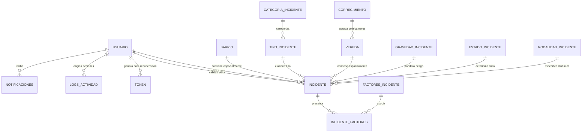

# MANUAL TÉCNICO DE ARQUITECTURA Y DESARROLLO
## Sistema de Información Geográfica de Incidentes — SIGI
**Guía para Administradores de Infraestructura, Ingenieros DevOps y Desarrolladores**

---

### Control del Documento
- **Proyecto:** SIGI - Sistema de Información Geográfica de Incidentes
- **Institución:** Servicio Nacional de Aprendizaje (SENA) — Regional Caquetá
- **Programa:** Análisis y Desarrollo de Software (ADSO) - Ficha 3142784
- **Autor Principal:** Daniel Felipe Vera Perdomo
- **Despliegue Oficial en Producción:** [https://sigi.verapd.xyz](https://sigi.verapd.xyz)
- **Versión del Manual:** 2.1 (Actualización Integral con Arquitectura Limpia, Modelos, Machine Learning, WebSockets y PWA)
- **Fecha:** Octubre 2026
- **Ámbito:** Guía Técnica de Mantenimiento, Despliegue, APIs, Base de Datos y Machine Learning

---

## ÍNDICE GENERAL

1. [INTRODUCCIÓN Y ARQUITECTURA GENERAL](#1-introducción-y-arquitectura-general)
   1.1 [Propósito del Manual Técnico](#11-propósito-del-manual-técnico)
   1.2 [Estructura del Proyecto y Directorios (Clean Architecture)](#12-estructura-del-proyecto-y-directorios-clean-architecture)
2. [DISEÑO Y ESPECIFICACIÓN DE BASE DE DATOS (POSTGRESQL + POSTGIS)](#2-diseño-y-especificación-de-base-de-datos-postgresql--postgis)
   2.1 [Diagrama Entidad-Relación Extendido](#21-diagrama-entidad-relación-extendido)
   2.2 [Diccionario Exhaustivo de Tablas](#22-diccionario-exhaustivo-de-tablas)
   2.3 [Lógica Geoespacial y Consultas Topológicas (ST_Contains, GiST)](#23-lógica-geoespacial-y-consultas-topológicas-st_contains-gist)
   2.4 [Scripts de Inicialización y Migraciones](#24-scripts-de-inicialización-y-migraciones)
3. [ARQUITECTURA BACKEND (NODE.JS, EXPRESS 5 & CLEAN ARCHITECTURE)](#3-arquitectura-backend-nodejs-express-5--clean-architecture)
   3.1 [Ciclo de Vida de una Petición y Cadena de Middlewares](#31-ciclo-de-vida-de-una-petición-y-cadena-de-middlewares)
   3.2 [Capa de Modelos Desacoplada (Model Layer Pattern)](#32-capa-de-modelos-desacoplada-model-layer-pattern)
   3.3 [Control de Acceso Basado en Roles (RBAC) y Sesiones](#33-control-de-acceso-basado-en-roles-rbac-y-sesiones)
   3.4 [Mecanismo de Bloqueo Concurrente (Locking) en la Mesa de Validación](#34-mecanismo-de-bloqueo-concurrente-locking-en-la-mesa-de-validación)
   3.5 [Ingesta Masiva CSV con Rollback Atómico](#35-ingesta-masiva-csv-con-rollback-atómico)
4. [SERVICIOS AUXILIARES, MACHINE LEARNING Y COMUNICACIÓN](#4-servicios-auxiliares-machine-learning-y-comunicación)
   4.1 [Integración Multimedia con Cloudinary (Upload Streaming & Fallback)](#41-integración-multimedia-con-cloudinary-upload-streaming--fallback)
   4.2 [Servicio Transaccional de Correo (Nodemailer SMTP & Simulador)](#42-servicio-transaccional-de-correo-nodemailer-smtp--simulador)
   4.3 [Módulo de Inteligencia Artificial (Naive Bayes, DBSCAN & Forecasting)](#43-módulo-de-inteligencia-artificial-naive-bayes-dbscan--forecasting)
   4.4 [Comunicación Push en Tiempo Real (Socket.io & Web Audio)](#44-comunicación-push-en-tiempo-real-socketio--web-audio)
   4.5 [Resiliencia Fuera de Línea PWA (Service Worker & Cola Local)](#45-resiliencia-fuera-de-línea-pwa-service-worker--cola-local)
   4.6 [Generador de Reportes Formales PDF (PDFKit)](#46-generador-de-reportes-formales-pdf-pdfkit)
   4.7 [Módulo Centralizado de Auditoría (Logger Forense)](#47-módulo-centralizado-de-auditoría-logger-forense)
5. [CATÁLOGO DE ENDPOINTS Y API REST](#5-catálogo-de-endpoints-y-api-rest)
   5.1 [Autenticación y Seguridad (`/api/auth`)](#51-autenticación-y-seguridad-apiauth)
   5.2 [Geografía y Cartografía (`/api/geografia`)](#52-geografía-y-cartografía-apigeografia)
   5.3 [Gestión de Incidentes y Validación (`/api/incidentes`)](#53-gestión-de-incidentes-y-validación-apiincidentes)
   5.4 [Catálogos y Control Cromático (`/api/catalogos`)](#54-catálogos-y-control-cromático-apicatalogos)
   5.5 [Inteligencia Artificial y Analítica Espacial (`/api/ml`)](#55-inteligencia-artificial-y-analítica-espacial-apiml)
   5.6 [Generación de Reportes PDF (`/api/reportes`)](#56-generación-de-reportes-pdf-apireportes)
   5.7 [Gobernanza y Auditoría (`/api/usuarios` & `/api/auditoria`)](#57-gobernanza-y-auditoría-apiusuarios--apiauditoria)
   5.8 [Estadísticas y Analítica KPI (`/api/estadisticas`)](#58-estadísticas-y-analítica-kpi-apiestadisticas)
6. [GUÍA DE INSTALACIÓN, CONFIGURACIÓN Y DESPLIEGUE EN PRODUCCIÓN](#6-guía-de-instalación-configuración-y-despliegue-en-producción)
   6.1 [Requisitos Previos del Sistema Operativo](#61-requisitos-previos-del-sistema-operativo)
   6.2 [Configuración Paso a Paso en Entorno Local](#62-configuración-paso-a-paso-en-entorno-local)
   6.3 [Despliegue en Producción en sigi.verapd.xyz (Nginx, PM2, SSL)](#63-despliegue-en-producción-en-sigiverapdxyz-nginx-pm2-ssl)
7. [PLAN DE PRUEBAS AUTOMATIZADAS (JEST & SUPERTEST — 70/70 TESTS)](#7-plan-de-pruebas-automatizadas-jest--supertest---7070-tests)
   7.1 [Configuración de Pruebas](#71-configuración-de-pruebas)
   7.2 [Ejecución de Pruebas y Cobertura de Código](#72-ejecución-de-pruebas-y-cobertura-de-código)

---

## 1. INTRODUCCIÓN Y ARQUITECTURA GENERAL

### 1.1 Propósito del Manual Técnico
Este documento proporciona toda la información de bajo nivel requerida para comprender, desplegar, extender, depurar y asegurar el **Sistema de Información Geográfica de Incidentes (SIGI)**, disponible en producción en **https://sigi.verapd.xyz**. Está concebido para ingenieros de desarrollo, administradores de bases de datos (DBA), analistas de infraestructura y evaluadores del SENA.

### 1.2 Estructura del Proyecto y Directorios (Clean Architecture)
El proyecto adopta una Arquitectura Limpia (*Clean Architecture*) organizada en capas desacopladas donde los controladores no acceden directamente a la base de datos, sino a través de clases de modelo especializadas:

```
SIGI/
├── config/                  # Configuraciones centralizadas de conexión y entorno
│   ├── db.config.js         # Parámetros de conexión PostgreSQL desde .env
│   └── db.js                # Instancia centralizada de pg.Pool y healthcheck
├── models/                  # Capa de Modelos (Clean Architecture - Consultas SQL encapsuladas)
│   ├── catalogos.model.js   # Tipos de incidente, categorías y validación Redmean
│   ├── estadisticas.model.js# Agregaciones estadísticas, métricas y datos para PDF
│   ├── geografia.model.js   # Consultas espaciales de polígonos GeoJSON (barrios/veredas)
│   ├── incidente.model.js   # CRUD de incidentes, candados concurrentes y filtros espaciales
│   └── usuario.model.js     # Gestión de usuarios, autenticación y protección de Superadmin
├── services/                # Servicios de lógica de negocio compleja
│   └── ml.service.js        # Naive Bayes NLP, heurísticas de auxilio, DBSCAN y Forecast
├── controllers/             # Controladores limpios de orquestación HTTP
│   ├── auth.controller.js
│   ├── catalogos.controller.js
│   ├── estadisticas.controller.js
│   ├── geografia.controller.js
│   ├── incidentes.controller.js
│   ├── ml.controller.js     # Predicción, reentrenamiento y analítica espacial
│   ├── reportes.controller.js # Compilación y despacho de informes en PDF con PDFKit
│   ├── tablas.controller.js
│   └── usuarios.controller.js
├── middleware/              # Filtros de seguridad, autenticación y errores
│   ├── auth.middleware.js   # Guards de sesión, RBAC y estado activo
│   └── error.middleware.js  # Manejo centralizado de excepciones HTTP
├── routes/                  # Definición de rutas y endpoints de la API
│   ├── auth.routes.js
│   ├── autocompletado.routes.js
│   ├── catalogos.routes.js
│   ├── estadisticas.routes.js
│   ├── filtros.routes.js
│   ├── geografia.routes.js
│   ├── incidentes.routes.js
│   ├── ml.routes.js         # Rutas de Machine Learning y analítica predictiva
│   ├── reportes.routes.js   # Ruta de descarga de reportes ejecutivos PDF
│   ├── tablas.routes.js
│   └── usuarios.routes.js
├── sql/                     # Scripts de estructura DDL, DML y migraciones
│   ├── schema.sql           # Esquema base con PostGIS
│   ├── migration_v2.sql     # Migración integral V2 (RBAC, estados, gravedad)
│   ├── migration_falta.sql  # Control de cambio de contraseña y tokens
│   └── migrate_passwords.sql
├── utils/                   # Módulos transversales utilitarios
│   ├── cloudinary.js        # Integración SDK Cloudinary + fallback local
│   ├── logger.js            # Inserción en logs_actividad
│   └── mailer.js            # Servicio SMTP Nodemailer + simulador dev
├── public/                  # Aplicación de cliente Frontend y recursos PWA
│   ├── css/                 # Hojas de estilo modulares (index, dashboard, etc.)
│   ├── js/                  # Scripts clientes asíncronos y mapas Leaflet
│   │   ├── pwa-offline.js   # Gestor de conectividad y cola offline en localStorage
│   │   ├── sigi-ml-assistant.js # Asistente predictivo en tiempo real con debouncing
│   │   └── sigi-realtime.js # Cliente WebSocket Socket.io con síntesis Web Audio
│   ├── sw.js                # Service Worker para cacheo de assets e interfaz offline
│   ├── manifest.json        # Manifiesto PWA para instalación en Android/iOS
│   ├── dashboard/           # Consola administrativa y geoportal analítico
│   └── reportero/           # Formulario optimizado para captura móvil en terreno
├── tests/                   # Suite de pruebas automatizadas Jest/Supertest (70/70)
├── db.js                    # Proxy de compatibilidad regresiva que exporta config/db.js
├── server.js                # Punto de entrada Express, servidor HTTP y Socket.io
├── package.json             # Manifiesto de dependencias y scripts de ejecución
└── .env                     # Variables de entorno confidenciales
```

---

## 2. DISEÑO Y ESPECIFICACIÓN DE BASE DE DATOS (POSTGRESQL + POSTGIS)

### 2.1 Diagrama Entidad-Relación Extendido




### 2.2 Diccionario Exhaustivo de Tablas

#### Tabla: `incidente` (Tabla Central del Negocio)
| Columna | Tipo de Dato | Restricción | Descripción |
| :--- | :--- | :--- | :--- |
| `idincidente` | `SERIAL` | `PK` | Identificador único secuencial del registro. |
| `codigoincidente` | `VARCHAR(50)` | `UNIQUE, NOT NULL` | Código alfanumérico público de radicado (ej: `INC-482910`). |
| `descripcionincidente` | `TEXT` | `NOT NULL` | Relato detallado de los hechos ocurridos. |
| `fechaincidente` | `DATE` | `NOT NULL` | Fecha de materialización del evento. |
| `horaincidente` | `TIME` | `NOT NULL` | Hora registrada del suceso. |
| `geom` | `geometry(Point, 4326)` | `NOT NULL` | Objeto geométrico del punto espacial (Longitud, Latitud WGS84). |
| `idtipoincidente` | `INTEGER` | `FK -> tipo_incidente` | Categoría tipológica del evento. |
| `id_gravedad` | `INTEGER` | `FK -> gravedad_incidente` | Nivel de severidad (1: Muy baja a 5: Crítica). |
| `id_estado` | `INTEGER` | `FK -> estado_incidente` | Estado del incidente (1: Reportado, 5: Resuelto, etc.). |
| `id_modalidad` | `INTEGER` | `FK -> modalidad_incidente` | Modalidad de comisión (arma de fuego, cortopunzante, etc.). |
| `idbarrio` | `INTEGER` | `FK -> barrio(gid)` | Identificador del barrio asignado por contención espacial. |
| `idvereda` | `INTEGER` | `FK -> vereda(id)` | Identificador de la vereda asignada por contención espacial. |
| `direccion` | `TEXT` | `NULL` | Nomenclatura urbana o referencia descriptiva del lugar. |
| `imagen_url` | `TEXT` | `NULL` | Enlace seguro HTTPS hacia la evidencia en Cloudinary. |
| `idusuario` | `INTEGER` | `FK -> usuario` | Identificador del usuario que registró el reporte. |
| `id_usuario_creador` | `INTEGER` | `FK -> usuario` | Auditoría de creación original. |
| `id_usuario_editor` | `INTEGER` | `FK -> usuario` | Último usuario que modificó o validó el incidente. |
| `id_admin_revisor` | `INTEGER` | `FK -> usuario` | Administrador que emitió el dictamen de validación. |
| `locked_by` | `INTEGER` | `FK -> usuario` | ID del analista que tiene bloqueado el caso en la cola. |
| `locked_at` | `TIMESTAMP` | `NULL` | Marca de tiempo del bloqueo (caduca a los 10 minutos). |
| `origen` | `VARCHAR(20)` | `DEFAULT 'manual'` | Fuente de los datos (`'manual'`, `'movil'`, `'importacion'`). |
| `lote_importacion` | `VARCHAR(50)` | `NULL` | Hash o marca de lote de importación masiva para rollback. |

#### Tabla: `usuario`
| Columna | Tipo | Restricción | Descripción |
| :--- | :--- | :--- | :--- |
| `idusuario` | `SERIAL` | `PK` | ID interno del usuario. |
| `nombreusuario` | `VARCHAR(50)` | `UNIQUE, NOT NULL` | Nombre de acceso único al sistema. |
| `contraseniausuario`| `VARCHAR(255)` | `NOT NULL` | Hash Bcrypt (10 rondas de costo) de la clave. |
| `email` | `VARCHAR(150)` | `UNIQUE, NOT NULL` | Correo electrónico para notificaciones y token. |
| `rol` | `VARCHAR(20)` | `DEFAULT 'reportero'` | Rol RBAC: `superadmin`, `admin`, `reportero`. |
| `estado` | `VARCHAR(20)` | `DEFAULT 'activo'` | Estado operativo: `activo`, `inactivo`, `suspendido`. |
| `entidadusuario` | `VARCHAR(100)` | `NOT NULL` | Dependencia o institución (Policía, Alcaldía, SENA). |
| `debe_cambiar_password` | `BOOLEAN` | `DEFAULT false` | Flag que fuerza cambio de contraseña en login. |
| `ultimo_acceso` | `TIMESTAMP` | `NULL` | Registro de auditoría del último inicio de sesión. |

#### Tabla: `logs_actividad`
Almacena la bitácora inmutable de eventos sensibles:
- `id_log`: Serial PK.
- `id_usuario`: FK al usuario responsable.
- `accion`: Tipo de operación (`CREACION_INCIDENTE`, `BLOQUEO_LOCK`, `APROBACION`, `IMPORTACION_MASIVA`, etc.).
- `tabla_afectada`: Nombre de la tabla modificada.
- `id_registro`: ID de la entidad involucrada.
- `descripcion`: Resumen legible del cambio.
- `ip`: Dirección IP del solicitante.
- `user_agent`: Cabecera del navegador cliente.
- `fecha`: Timestamp automático con zona horaria.

---

### 2.3 Lógica Geoespacial y Consultas Topológicas (ST_Contains, GiST)

Una de las innovaciones nucleares de SIGI es la **autolocalización topológica**. Cuando un usuario radica un incidente con latitud y longitud, el servidor no le exige al usuario saber a qué barrio o vereda pertenece; el motor de base de datos lo calcula automáticamente mediante la función espacial `ST_Contains`:

```sql
-- Detección automática del Barrio Urbano en PostGIS:
SELECT gid FROM barrio
WHERE ST_Contains(geom, ST_SetSRID(ST_MakePoint($1, $2), 4326))
LIMIT 1;

-- Detección automática de la Vereda Rural:
SELECT id FROM vereda
WHERE ST_Contains(geom, ST_SetSRID(ST_MakePoint($1, $2), 4326))
LIMIT 1;
```

#### Indexación GiST para Rendimiento Sub-Segundo:
Para evitar escaneos secuenciales que degradarían el sistema al manejar geometrías poligonales complejas, se crearon índices basados en árboles de búsqueda generalizada (*GiST*):
```sql
CREATE INDEX idx_incidente_geom ON incidente USING GIST (geom);
CREATE INDEX idx_barrio_geom ON barrio USING GIST (geom);
CREATE INDEX idx_vereda_geom ON vereda USING GIST (geom);
```

---

## 3. ARQUITECTURA BACKEND (NODE.JS, EXPRESS 5 & CLEAN ARCHITECTURE)

### 3.1 Ciclo de Vida de una Petición y Cadena de Middlewares
Cada petición HTTP entrante recorre una tubería (*pipeline*) de seguridad antes de alcanzar los controladores:

```
[Cliente HTTP / Navegador / PWA]
      │ (Petición HTTPS / WSS)
      ▼
1. Helmet Middleware (Aplica directivas de cabeceras seguras)
      ▼
2. Express-Rate-Limit (Valida cuota de peticiones por IP)
      ▼
3. Body Parsers (express.json() y multer en memoria si es multipart)
      ▼
4. Express-Session (Deserializa cookie de sesión firmada HttpOnly)
      ▼
5. Route Guard: verificarSesion (Valida idusuario en sesión activa)
      ▼
6. Route Guard: verificarEstadoActivo (Comprueba que el usuario no esté inactivo)
      ▼
7. Route Guard: verificarRol('admin', 'superadmin') (Valida privilegios RBAC)
      ▼
8. Controller Execution (Lógica de orquestación y validación de entrada)
      ▼
9. Services / Models Layer (Inferencia ML o ejecución de query SQL parametrizada)
      ▼
10. Centralized Error Handler (Captura excepciones y responde JSON controlado)
```

---

### 3.2 Capa de Modelos Desacoplada (Model Layer Pattern)
Para cumplir con los principios de Arquitectura Limpia y Responsabilidad Única (SOLID), se desacopló el 100% del SQL de los controladores, trasladándolo a clases estáticas en `models/`:

- **`IncidenteModel` (`models/incidente.model.js`):** Gestiona la consulta de incidentes con filtros espaciales GiST, adquisición/liberación atómica del candado de concurrencia y transiciones de estado.
- **`UsuarioModel` (`models/usuario.model.js`):** Encapsula la autenticación, creación de credenciales, tokens de reseteo y la regla de salvaguarda institucional `contarSuperadminsActivos()` que previene la auto-inactivación del último superadministrador.
- **`CatalogosModel` (`models/catalogos.model.js`):** Centraliza la administración de tipologías, categorías e integridad referencial (prohibición de borrado de tipos con reportes vinculados).
- **`EstadisticasModel` (`models/estadisticas.model.js`):** Ejecuta agregaciones complejas (`COUNT`, `GROUP BY`, ventanas temporales) para alimentar tableros KPI y el generador de reportes PDF.
- **`GeografiaModel` (`models/geografia.model.js`):** Ejecuta consultas topológicas `ST_AsGeoJSON` para el renderizado vectorial de barrios y veredas.
- **Pool de Conexiones (`config/db.js`):** Gestiona el ciclo de vida de `pg.Pool`, balanceando hilos y evitando fugas de memoria con proxies en `db.js`.

---

### 3.3 Control de Acceso Basado en Roles (RBAC) y Sesiones
El archivo `middleware/auth.middleware.js` implementa los inspectores de autorización:
```javascript
const verificarSesion = (req, res, next) => {
  if (req.session && req.session.idusuario) {
    return next();
  }
  return res.status(401).json({ mensaje: "Sesión no válida o expirada. Por favor inicie sesión." });
};

const verificarRol = (...rolesPermitidos) => {
  return (req, res, next) => {
    const rolUsuario = req.session.rol;
    if (!rolUsuario || !rolesPermitidos.includes(rolUsuario)) {
      return res.status(403).json({ mensaje: "Acceso denegado: Privilegios insuficientes." });
    }
    next();
  };
};

const verificarEstadoActivo = async (req, res, next) => {
  const usuario = await UsuarioModel.buscarPorId(req.session.idusuario);
  if (!usuario || usuario.estado !== 'activo') {
    req.session.destroy();
    return res.status(403).json({ mensaje: "Cuenta inactiva o suspendida institucionalmente." });
  }
  next();
};
```

---

### 3.4 Mecanismo de Bloqueo Concurrente (Locking) en la Mesa de Validación
Para evitar que dos administradores validen o dictaminen simultáneamente el mismo incidente:

1. **Adquisición del Bloqueo (`/api/incidentes/:id/tomar`):**
   ```sql
   UPDATE incidente
   SET locked_by = $1, locked_at = CURRENT_TIMESTAMP
   WHERE idincidente = $2
     AND (locked_by IS NULL OR locked_by = $1 OR locked_at < NOW() - INTERVAL '10 minutes')
   RETURNING idincidente;
   ```
2. **Resultado Atómico:** Si la consulta actualiza una fila, el bloqueo fue otorgado. Si retorna cero filas, significa que otro analista ya tomó el control del caso y aún no ha vencido su ventana de 10 minutos.
3. **Liberación del Bloqueo:** Al dictaminar (aprobar o desestimar) o al hacer clic en "Liberar Caso":
   ```sql
   UPDATE incidente SET locked_by = NULL, locked_at = NULL WHERE idincidente = $1;
   ```

---

### 3.5 Ingesta Masiva CSV con Rollback Atómico
La importación masiva en `incidentes.controller.js` utiliza la librería `csv-parser` procesando el fichero mediante flujos (*streams*) en memoria:
- Cada fila es analizada validando: formato de fecha `YYYY-MM-DD`, hora `HH:MM`, coordenadas numéricas válidas en rango de Florencia y tipo de incidente existente.
- A todo el bloque importado se le asigna un identificador de lote: `lote_importacion = 'LOTE_' + Date.now()`.
- **Rollback Inmediato:** Mediante el endpoint `DELETE /api/incidentes/importados/ultimo`, el administrador puede deshacer la última carga masiva sin afectar registros previos:
  ```sql
  DELETE FROM incidente
  WHERE lote_importacion = (SELECT lote_importacion FROM incidente WHERE lote_importacion IS NOT NULL ORDER BY idincidente DESC LIMIT 1);
  ```

---

## 4. SERVICIOS AUXILIARES, MACHINE LEARNING Y COMUNICACIÓN

### 4.1 Integración Multimedia con Cloudinary (Upload Streaming & Fallback)
El módulo `utils/cloudinary.js` implementa carga segura en la nube:
- Se evita la escritura en disco del servidor usando buffers directos de `multer.memoryStorage`.
- La imagen se procesa con el SDK oficial v2 de Cloudinary utilizando DataURIs en Base64 con compresión WebP automática.
- **Tolerancia a Fallos (Fallback):** Si Cloudinary no está configurado o falla, conmuta automáticamente a almacenamiento local en `public/uploads/incidentes/`.

### 4.2 Servicio Transaccional de Correo (Nodemailer SMTP & Simulador)
El componente `utils/mailer.js` ofrece soporte para servidores SMTP empresariales con cifrado SSL/TLS.
- **Modo Simulador:** Si no se suministran credenciales SMTP en `.env`, el sistema imprime los correos, asuntos y tokens de acceso directamente en la consola sin interrumpir la ejecución.

### 4.3 Módulo de Inteligencia Artificial (Naive Bayes, DBSCAN & Forecasting)
El módulo `services/ml.service.js` implementa analítica predictiva nativa en Node.js:
1. **Clasificador NLP Supervisado:** Algoritmo **Multinomial Naive Bayes** con suavizado de Laplace ($k=1$) entrenado sobre un léxico de jerga y terminología de incidentes en Colombia (hurto, fleteo, asalto, agresión, piques, riñas, etc.).
2. **Estimador de Gravedad y Detección de Auxilio:** Ponderación léxica que clasifica la severidad (1 a 5) e infiere la necesidad de despacho de Policía Nacional, Ambulancia/Salud o Bomberos.
3. **Clustering Espacial DBSCAN:** Identificación matemática de núcleos de concentración (*Hotspots*) con distancia haversine en `/api/ml/hotspots`.
4. **Forecasting Temporal:** Suavizado exponencial y cálculo de medias móviles para proyectar el volumen criminal esperado del ciclo siguiente en `/api/ml/forecast`.
5. **Reentrenamiento Continuo:** Endpoint protegido `POST /api/ml/reentrenar` que lee los casos formalmente validados en PostgreSQL y recalcula las tablas de probabilidad léxica en caliente.

### 4.4 Comunicación Push en Tiempo Real (Socket.io & Web Audio)
El servidor implementa WebSockets mediante **Socket.io** en `server.js`:
- Emite eventos globales `nuevo_incidente` cuando un reportero radica un caso y `incidente_actualizado` cuando un analista adquiere un candado o emite dictamen.
- El cliente `public/js/sigi-realtime.js` escucha estos eventos, actualiza el mapa Leaflet y las tablas reactivamente sin recargar la página.
- Sintetiza tonos de notificación utilizando la **Web Audio API** (oscilador senoidal en frecuencias 587.33 Hz [D5] a 880.00 Hz [A5]), garantizando feedback sonoro sin descargas de audio pesadas.

### 4.5 Resiliencia Fuera de Línea PWA (Service Worker & Cola Local)
- `public/sw.js`: Service Worker que cachea los activos estáticos y vistas para permitir carga instantánea sin conexión.
- `public/js/pwa-offline.js`: Intercepta los envíos del formulario cuando `navigator.onLine === false`, almacena los registros con sus coordenadas en `localStorage` (`sigi_cola_incidentes_offline`) y los despacha automáticamente al detectar el evento `online`.
- `public/manifest.json`: Configura la instalación de SIGI como aplicación progresiva nativa en dispositivos Android e iOS.

### 4.6 Generador de Reportes Formales PDF (PDFKit)
El controlador `controllers/reportes.controller.js` utiliza la librería **PDFKit**:
- Genera documentos vectoriales en tamaño carta con cabecera institucional `#0f172a`, fecha de corte, KPIs del período, distribución de delitos, análisis de zonas críticas y pronósticos de Machine Learning.
- Entrega el resultado vía streaming HTTP (`application/pdf`) con soporte para previsualización inline (`preview=1`) o descarga directa.

### 4.7 Módulo Centralizado de Auditoría (Logger Forense)
El módulo `utils/logger.js` registra de forma inmutable cada operación sensible en la tabla `logs_actividad` vinculando el ID de usuario, la acción ejecutada, la tabla afectada, la dirección IP y el navegador del cliente.

### 4.8 Módulo de Seguridad de Red y Control de IPs Bloqueadas (GestorIpsBloqueadas)
El componente `utils/gestorIps.js` y el controlador `controllers/seguridad.controller.js` conforman la capa de defensa perimetral activa contra ataques de fuerza bruta:
- **Gestión en Memoria y Expiración Automática:** Registra las direcciones IP suspendidas al alcanzar 5 intentos fallidos en `/login`, gestionando una ventana móvil de 15 minutos con cálculo reactivo de segundos y minutos restantes.
- **Normalización de Red (IPv4/IPv6):** Transforma direcciones locales `::1` y prefijos `::ffff:` a `127.0.0.1` de forma transparente, unificando la generación de claves del limitador de tasa (`keyGenerator`).
- **Desbloqueo Perimetral Atómico:** Al recibir la orden de desbloqueo de un Superadministrador, purga concurrentemente todas las variantes de clave en `loginLimiter` (`127.0.0.1`, `::1`, `::/56`, `::ffff:127.0.0.1`), registra la acción en la bitácora de auditoría forense (`DESBLOQUEAR_IP`) y sincroniza la interfaz gráfica en tiempo real mediante WebSockets (`ip_desbloqueada`).

---

## 5. CATÁLOGO DE ENDPOINTS Y API REST

### 5.1 Autenticación y Seguridad (`/api/auth`)
- `POST /api/auth/login`: Autentica credenciales y establece la sesión protegida con cookie HttpOnly.
- `POST /api/auth/logout`: Destruye la sesión activa y limpia las cookies de autenticación.
- `GET /api/auth/perfil`: Retorna el perfil y rol del usuario autenticado en sesión.
- `POST /api/auth/cambiar-password-obligatorio`: Actualiza la contraseña en el primer inicio de sesión.
- `POST /api/auth/solicitar-recuperacion`: Genera un token criptográfico de 64 hex y despacha el correo de restablecimiento.
- `POST /api/auth/reset-password`: Aplica la nueva contraseña validando la vigencia del token.

### 5.2 Geografía y Cartografía (`/api/geografia`)
- `GET /api/geografia/barrios`: Retorna FeatureCollection GeoJSON con los polígonos de los barrios urbanos de Florencia.
- `GET /api/geografia/veredas`: Retorna FeatureCollection GeoJSON con los polígonos de las veredas rurales.

### 5.3 Gestión de Incidentes y Validación (`/api/incidentes`)
- `GET /api/incidentes`: Consulta pública y filtrada de incidentes aprobados/resueltos.
- `GET /api/incidentes/pendientes`: Retorna los casos en cola de validación (Solo Admin/Superadmin).
- `GET /api/incidentes/mis-reportes`: Retorna el historial de casos radicados por el reportero en sesión.
- `POST /api/incidentes`: Radicación de incidente en campo con coordenadas GPS y evidencia fotográfica multipart.
- `POST /api/incidentes/:id/tomar`: Adquiere el candado concurrente de revisión (10 minutos de vigencia).
- `POST /api/incidentes/:id/liberar`: Libera voluntariamente el candado de revisión devolviendo el caso a la cola.
- `POST /api/incidentes/:id/resolver`: Dictamina el incidente como Aprobado/Resuelto y lo publica en el mapa.
- `POST /api/incidentes/:id/cerrar`: Desestima el incidente con justificación técnica obligatoria.
- `POST /api/importar-incidentes`: Ingesta masiva transaccional mediante fichero CSV.
- `DELETE /api/incidentes/importados/ultimo`: Revierte (*rollback*) atómicamente el último lote de importación.

### 5.4 Catálogos y Control Cromático (`/api/catalogos`)
- `GET /api/catalogos/tipos`: Retorna el listado de tipos de incidentes con su paleta de colores y niveles de riesgo.
- `POST /api/catalogos/tipos`: Crea un nuevo tipo de incidente con validación de distancia cromática Redmean ($\Delta C < 85$) y anti-duplicados.
- `PUT /api/catalogos/tipos/:id`: Actualiza la tipología y color validando contraste visual.
- `DELETE /api/catalogos/tipos/:id`: Elimina tipologías delictivas garantizando integridad referencial (bloqueo ante registros históricos).

### 5.5 Inteligencia Artificial y Analítica Espacial (`/api/ml`)
- `POST /api/ml/predecir-incidente`: Analiza la descripción textual y retorna tipología, confianza, severidad y servicios de auxilio sugeridos.
- `GET /api/ml/hotspots`: Retorna clústeres espaciales densos calculados mediante DBSCAN.
- `GET /api/ml/forecast`: Retorna predicción de series de tiempo de volumen criminal para el siguiente mes.
- `POST /api/ml/reentrenar`: Reentrena el clasificador Naive Bayes con los datos consolidados en BD (Admin/Superadmin).

### 5.6 Generación de Reportes PDF (`/api/reportes`)
- `GET /api/reportes/pdf`: Genera y descarga el informe ejecutivo mensual oficial compilado con PDFKit (`mes`, `anio`, `preview`).

### 5.7 Gobernanza y Auditoría (`/api/usuarios` & `/api/auditoria`)
- `GET /api/usuarios`: Consulta el directorio institucional de usuarios (Superadmin).
- `POST /api/usuarios`: Alta de nuevo usuario, generación de clave temporal y despacho por email.
- `PUT /api/usuarios/:id/estado`: Cambio de estado (`activo`/`inactivo`) con blindaje para el último Superadmin activo.
- `GET /api/auditoria/logs`: Bitácora paginada y filtrable de eventos forenses en `logs_actividad`.

### 5.8 Estadísticas y Analítica KPI (`/api/estadisticas`)
- `GET /api/estadisticas/kpis`: Retorna métricas numéricas consolidadas (total casos, víctimas, pérdidas).
- `GET /api/estadisticas/conteoPorTipo`: Desglose cuantitativo por tipología para gráficos de dona.
- `GET /api/estadisticas/top-zonas`: Clasificación de los sectores con mayor incidencia.

### 5.9 Seguridad Perimetral e IPs Bloqueadas (`/api/seguridad`)
- `GET /api/seguridad/ips-bloqueadas`: Retorna el catálogo activo de direcciones IP suspendidas por fuerza bruta con su tiempo restante y métricas de red (Exclusivo Superadmin).
- `POST /api/seguridad/desbloquear-ip/:ip`: Desbloquea manualmente una dirección IP, purga su caché en `loginLimiter`, asienta el evento `DESBLOQUEAR_IP` en auditoría y difunde la actualización por WebSockets.
- `GET /api/estadisticas/tipos`: Distribución porcentual por tipología delictiva.
- `GET /api/estadisticas/zonas`: Top 10 sectores críticos (barrios y veredas con mayor recurrencia).
- `GET /api/estadisticas/temporalidad`: Distribución por franja horaria, día de la semana y estacionalidad mensual.

---

## 6. GUÍA DE INSTALACIÓN, CONFIGURACIÓN Y DESPLIEGUE EN PRODUCCIÓN

### 6.1 Requisitos Previos del Sistema Operativo
- Node.js v20.x LTS o superior instalado globalmente.
- PostgreSQL v15+ con extensión espacial PostGIS activada (`CREATE EXTENSION postgis;`).
- Nginx como servidor web inverso con módulo de proxy WebSockets.
- Git y gestor de procesos PM2 (`npm install -g pm2`).

### 6.2 Configuración Paso a Paso en Entorno Local
1. **Clonar el repositorio:**
   ```bash
   git clone https://github.com/DF-VeraP/SIGI.git
   cd SIGI
   ```
2. **Instalar dependencias:**
   ```bash
   npm install
   ```
3. **Inicializar y migrar base de datos:**
   ```bash
   psql -U postgres -d db_mapeo -f sql/schema.sql
   psql -U postgres -d db_mapeo -f sql/migration_v2.sql
   psql -U postgres -d db_mapeo -f sql/migration_falta.sql
   ```
4. **Configurar variables de entorno (`.env`):**
   ```env
   PORT=3000
   DB_USER=postgres
   DB_HOST=localhost
   DB_NAME=db_mapeo
   DB_PASSWORD=tu_password
   DB_PORT=5432
   SESSION_SECRET=clave_secreta_super_segura_de_produccion_2026
   APP_URL=https://sigi.verapd.xyz
   ```
5. **Iniciar en desarrollo:**
   ```bash
   npm run dev
   ```

### 6.3 Despliegue en Producción en sigi.verapd.xyz (Nginx, PM2, SSL)
El despliegue oficial se encuentra activo en el dominio **https://sigi.verapd.xyz**:

1. **Gestión de Proceso con PM2:**
   ```bash
   pm2 start server.js --name "sigi-prod" -i max
   pm2 save
   pm2 startup
   ```

2. **Configuración de Nginx Reverse Proxy (`/etc/nginx/sites-available/sigi.verapd.xyz`):**
   ```nginx
   server {
       server_name sigi.verapd.xyz;

       location / {
           proxy_pass http://127.0.0.1:3000;
           proxy_http_version 1.1;
           proxy_set_header Upgrade $http_upgrade;
           proxy_set_header Connection "upgrade";
           proxy_set_header Host $host;
           proxy_set_header X-Real-IP $remote_addr;
           proxy_set_header X-Forwarded-For $proxy_add_x_forwarded_for;
           proxy_set_header X-Forwarded-Proto $scheme;
           proxy_cache_bypass $http_upgrade;
           proxy_read_timeout 86400s;
           proxy_send_timeout 86400s;
       }

       listen 443 ssl http2;
       ssl_certificate /etc/letsencrypt/live/sigi.verapd.xyz/fullchain.pem;
       ssl_certificate_key /etc/letsencrypt/live/sigi.verapd.xyz/privkey.pem;
       include /etc/letsencrypt/options-ssl-nginx.conf;
       ssl_dhparam /etc/letsencrypt/ssl-dhparams.pem;
   }

   server {
       listen 80;
       server_name sigi.verapd.xyz;
       return 301 https://$host$request_uri;
   }
   ```

---

## 7. PLAN DE PRUEBAS AUTOMATIZADAS (JEST & SUPERTEST — 70/70 TESTS)

### 7.1 Configuración de Pruebas
Las pruebas se definen en el directorio `tests/` utilizando **Jest v30.4+** y **Supertest v7.2+** para certificar el 100% de los modelos, servicios de Machine Learning, controladores y flujos de autorización sin depender de navegadores externos.

### 7.2 Ejecución de Pruebas y Cobertura de Código
Para ejecutar la suite completa de pruebas automatizadas:
```bash
npm test
```
**Resultado Verificado:** **70/70 pruebas aprobadas exitosamente (100% PASS)**, certificando:
- Integridad de la capa de modelos (`models/*.model.js`).
- Precisión de inferencia y clustering del servicio de Machine Learning (`services/ml.service.js`).
- Seguridad de endpoints y control de acceso basado en roles RBAC.
- Generación y entrega de informes PDF vectorizados.
- Renderizado de topología y límites espaciales en formato GeoJSON.
